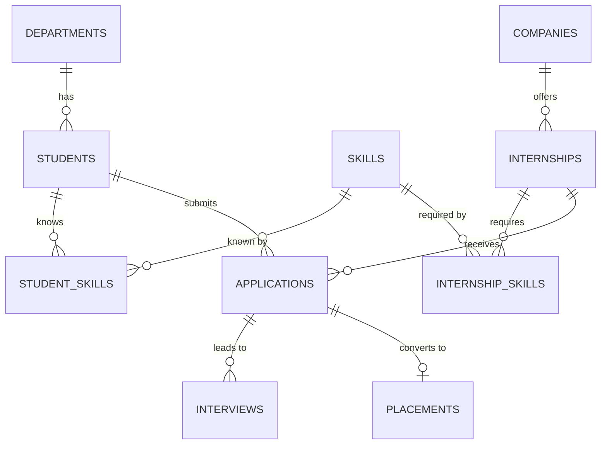

# College Internship & Skill Tracking System

Flask (Python) + MySQL 8. Tracks students, skills, companies, internships, applications, interviews and placements.

## Run
```
pip install flask mysql-connector-python
mysql -u root -p < schema.sql
set DB_USER=root & set DB_PASS=yourpassword      (Linux/Mac: export ...)
python app.py        -> http://127.0.0.1:5000
```

## ER diagram (paste into mermaid.live to render or export)


## Relational schema (PK underlined as *, FK as →)
- departments(*dept_id, dept_name)
- students(*student_id, name, email, dept_id→departments, cgpa, year)
- skills(*skill_id, skill_name, category)
- student_skills(*student_skill_id, student_id→students, skill_id→skills, level)
- companies(*company_id, company_name, industry, city, contact_email)
- internships(*internship_id, title, company_id→companies, stipend, duration_months, openings, deadline)
- internship_skills(*internship_skill_id, internship_id→internships, skill_id→skills)
- applications(*application_id, student_id→students, internship_id→internships, status, applied_on)
- interviews(*interview_id, application_id→applications, interview_date, mode, result)
- placements(*placement_id, application_id→applications, offer_date, ctc)

## Normalization (3NF)
- 1NF: all attributes atomic; skills are not stored as comma lists but in `student_skills` / `internship_skills`.
- 2NF: every non-key attribute depends on the whole key (junction tables use a surrogate key plus a UNIQUE pair).
- 3NF: no transitive dependencies. Department name lives in `departments`, company details in `companies`, so `students` and `internships` hold only the foreign key.

## Requirement checklist
| Requirement | Where |
|---|---|
| 10 tables, PK/FK, constraints | `schema.sql` (UNIQUE, CHECK, ENUM, NOT NULL, DEFAULT, ON DELETE CASCADE) |
| CRUD | Every table page: add, edit, delete (`app.py`) |
| Joins and subqueries | `/reports` |
| View | `v_application_details` |
| Trigger | `trg_placement_selected` (placement insert sets the application to Selected) |
| Stored procedure | `sp_skill_match` (ranks students for an internship) |
| Search/report | Search box on each table page, `/reports` |
| MySQL connectivity | `mysql.connector` in `app.py` |
